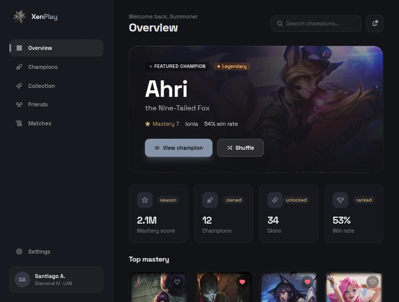
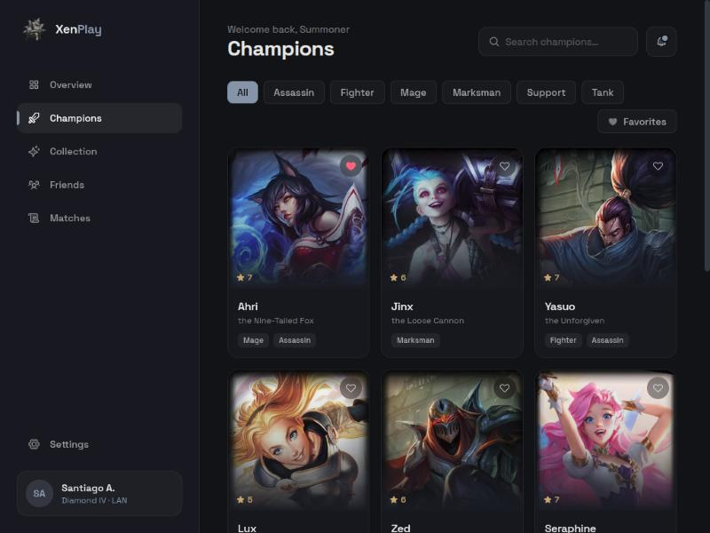
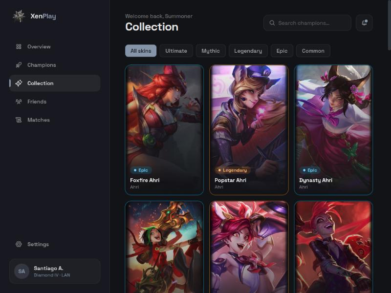
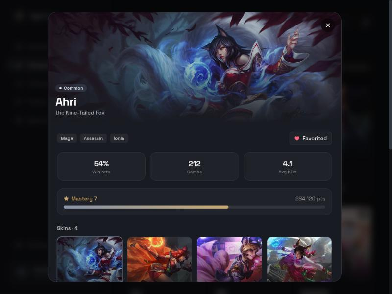

# XenPlay

A League of Legends companion dashboard. Browse champions, inspect their skins by rarity, track mastery and review a match history — all in a dark, responsive single-page app. Champion and skin artwork is pulled from Riot's public Data Dragon CDN; mastery, win rates, match data and the rarity tiers are sample data used to drive the interface.

This is a front-end portfolio project and is not affiliated with or endorsed by Riot Games.

**Live demo:** [gaming-dashboard-pearl.vercel.app](https://gaming-dashboard-pearl.vercel.app)



## Features

- **Overview** with a featured champion (shuffleable), aggregate stats, top-mastery champions and recent matches.
- **Champions** view with live text search, role filters and a favorites filter. Favorites persist in `localStorage`.
- **Collection** of skins grouped and filtered by rarity (Common through Ultimate), each card framed by its tier color.
- **Champion detail** modal with splash art, a skin selector, mastery progress and performance stats. Closes with the overlay or `Esc`.
- **Friends** panel with search, an online filter and invites that confirm with a toast.
- **Match history** with per-game KDA, CS and win/loss styling.
- Responsive from mobile (collapsible sidebar) to desktop, with hover and active states throughout.

## Stack

- React 19 with Vite
- Tailwind CSS v4
- react-icons
- Riot Data Dragon for champion and skin images

## Data

Images come from Data Dragon over a pinned patch (`src/lib/ddragon.js`). The roster, skin selection, rarity tiers, mastery and match data are defined under `src/data/` so the UI is fully populated without a backend. Swapping in a real API means replacing those modules.

## Running locally

```bash
git clone https://github.com/Sagudelo01/gaming-dashboard.git
cd gaming-dashboard
npm install
npm run dev
```

The app runs at `http://localhost:5173`.

| Script | Description |
|---|---|
| `npm run dev` | Start the dev server |
| `npm run build` | Production build |
| `npm run preview` | Serve the production build |
| `npm run lint` | Run ESLint |
| `npm test` | Run the test suite (Vitest) |

## Project structure

```
src/
├── components/   UI by responsibility (Sidebar, Topbar, Hero, views, modal)
├── data/         Champions, friends, matches and rarity definitions
├── hooks/        useFavorites, useLocalStorage, useToast
├── lib/          Data Dragon URLs and toast context
└── App.jsx       View routing and shared state
```

## Screenshots

| Champions | Collection |
|---|---|
|  |  |


