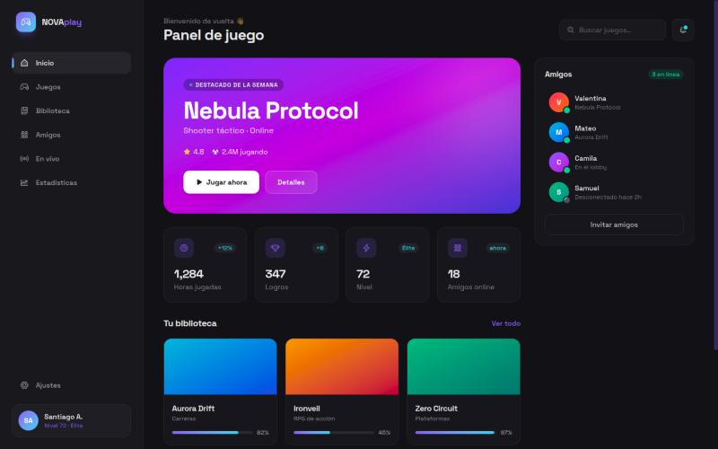
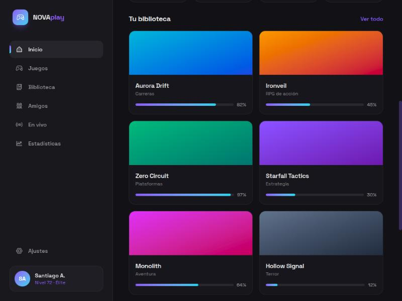

# NOVAplay — Gaming Dashboard 🎮

Panel de control para una plataforma de videojuegos: juego destacado, estadísticas del jugador, biblioteca con progreso y actividad de amigos. Interfaz oscura, futurista y totalmente responsive.



## ✨ Funcionalidades

- **Juego destacado** con portada animada y llamadas a la acción
- **Tarjetas de estadísticas** (horas, logros, nivel, amigos) con microinteracciones
- **Biblioteca** en grid con portadas en degradado y barra de progreso por juego
- **Panel de amigos** con estado en línea en tiempo real (mock)
- **Sidebar** colapsable con navegación y perfil del usuario
- **Diseño responsive**: de una columna en móvil a layout de dos paneles en escritorio

## 🛠️ Stack


## 🏗️ Arquitectura

```
src/
├── components/   # Sidebar, Topbar, Hero, StatsRow, Library, FriendsPanel
├── data.js       # Datos de ejemplo (juegos, stats, amigos)
├── index.css     # Tokens de diseño y utilidades (Tailwind v4)
└── App.jsx       # Composición del layout
```

La UI está dividida por responsabilidad y los datos viven separados de la presentación, de modo que conectar una API real solo implica reemplazar `data.js`.

## 🚀 Ejecución local

```bash
git clone https://github.com/Sagudelo01/gaming-dashboard.git
cd gaming-dashboard
npm install
npm run dev
```

Abre [http://localhost:5173](http://localhost:5173).

### Scripts

| Comando | Descripción |
|---|---|
| `npm run dev` | Servidor de desarrollo con HMR |
| `npm run build` | Build de producción |
| `npm run preview` | Previsualiza el build |
| `npm run lint` | Linter (ESLint) |

## 📚 Biblioteca


